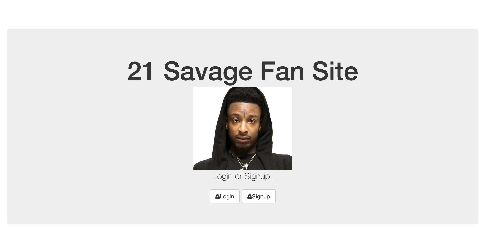

# Savage Auth

A message board with user accounts, where logged-in users post messages and vote on them.

**Live Demo:** [Live Site](https://savage-auth-7s3h.onrender.com/)

---

## About

Users sign up or log in with an email and password. Once logged in, they land on their profile page, where they can post a message, give any message a thumbs up or thumbs down, and delete messages with the trash icon. Messages are saved to MongoDB, so they stay after a refresh.

---

## Built With

Node.js, Express, MongoDB, Mongoose, EJS, Passport (local login), connect-flash, express-session

---

## Preview



---

## How It Works

- `server.js` connects to MongoDB, sets up sessions and Passport, and loads the routes
- `config/passport.js` handles signup and login
- `config/database.js` holds the MongoDB connection string
- `app/routes.js` has the page routes plus the routes for posting, voting, and deleting messages
- `public/main.js` sends the thumbs up, thumbs down, and delete requests with fetch

---

## Run It Locally

```bash
git clone https://github.com/smayanja3/savage-auth.git
cd savage-auth
npm install
```

The database URL is set in `config/database.js`. Replace it with your own MongoDB connection string. No `.env` file is needed, but you can set `PORT` if you want (defaults to 8080).

Then run `node server.js` and open `http://localhost:8080`.

---

## Credit

Modified from Scotch.io's auth tutorial.
